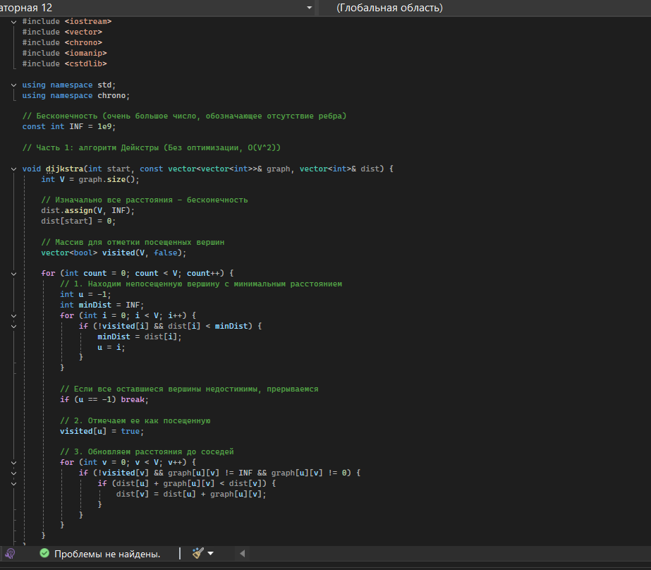
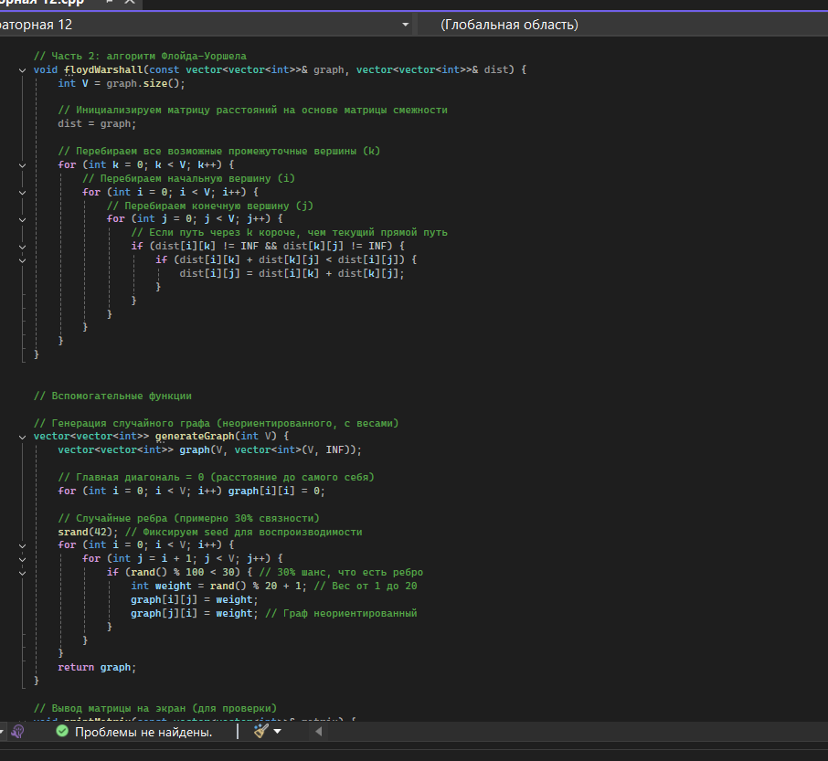
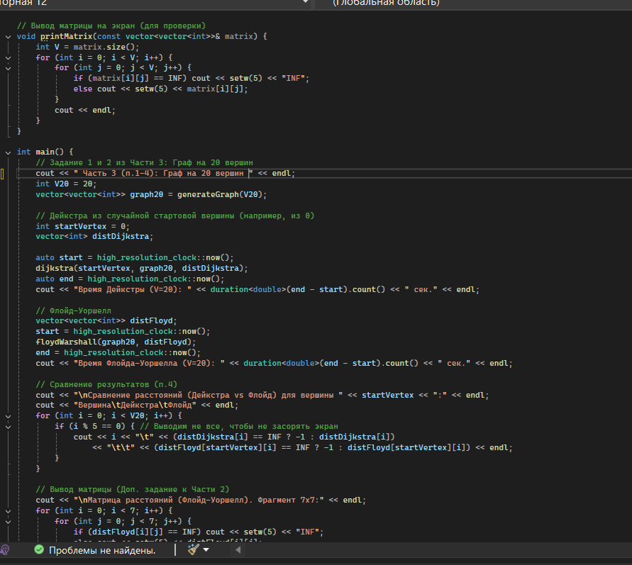
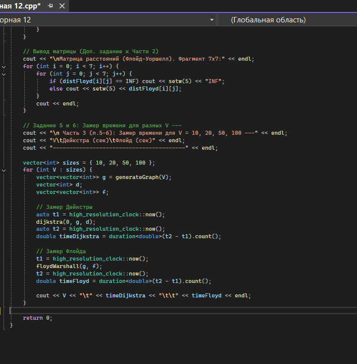
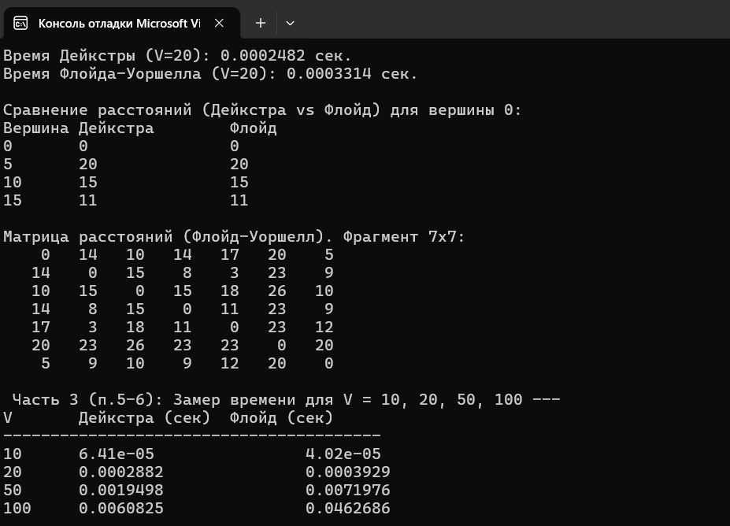

# Лабораторная работа №12
## Алгоритм Дейкстры. Алгоритм Флойда-Уоршелла

**Выполнила:** *Агафонова Софья Сергеевна*  
**Группа:** *ПИЖ-б-о-25-1*  
**Вариант:** 1 
---

## Цель работы

1. Реализовать алгоритм Дейкстры для нахождения кратчайших
путей от одной вершины до всех остальных во взвешенном графе
с неотрицательными весами
2. Реализовать алгоритм Флойда-Уоршелла для нахождения
кратчайших путей между всеми парами вершин
3. Изучить особенности работы алгоритмов с графами,
содержащими отрицательные веса
4. Научиться восстанавливать кратчайшие пути после выполнения
алгоритмов
5. Сравнить временную сложность и области применения
алгоритмов
---
# Теоретическая часть

**Алгоритм Дейкстры**
Алгоритм Дейкстры используется для поиска кратчайших путей от одной заданной вершины до всех остальных вершин во взвешенном графе. Главное условие — веса рёбер должны быть неотрицательными. Алгоритм работает жадно: на каждом шаге он выбирает непосещённую вершину с наименьшим текущим расстоянием от старта, помечает её как обработанную и обновляет (ослабляет) расстояния до всех её соседей. В простой реализации (через массивы) сложность составляет \(O(V^2)\), а при использовании приоритетной очереди на основе двоичной кучи — \(O((V + E) \log V)\), где V — число вершин, а E — число рёбер. Главный минус — алгоритм не работает с отрицательными весами.

**Алгоритм Флойда-Уоршелла**
Алгоритм Флойда-Уоршелла находит кратчайшие пути сразу между всеми парами вершин графа. Он основан на динамическом программировании и работает с матрицей смежности, где изначально записаны веса прямых рёбер. Суть алгоритма в трёх вложенных циклах: мы по очереди рассматриваем каждую вершину как промежуточную (транзитную) точку и проверяем, можно ли сократить путь из вершины i в вершину j, если проехать через эту промежуточную вершину k. Сложность алгоритма всегда составляет \(O(V^3)\), что делает его медленным для больших графов, но он очень прост в реализации. В отличие от алгоритма Дейкстры, Флойд-Уоршелл корректно работает с отрицательными весами рёбер (при условии отсутствия циклов отрицательной длины) и может использоваться для их обнаружения.

---
## Постановка задачи

Вот постановка задач по предоставленным скриншотам, оформленная в точно таком же стиле:

---

### Часть 1. 

| № вар. | Способ реализации | Особенности |
|:---:|:---|:---|
| **1** | **Без оптимизации (\(O(V^2)\))** | Неориентированный граф |

**Задание:**
1. Реализовать алгоритм Дейкстры для поиска кратчайших путей от одной вершины до всех остальных.
2. Использовать «классическую» реализацию **без оптимизации** (на массивах), сложность которой составляет \(O(V^2)\).
3. Граф должен быть **неориентированным** и взвешенным (веса неотрицательные).
4. Вывести кратчайшие расстояния от заданной стартовой вершины до всех остальных вершин.

---

### Часть 2. 

| № вар. | Особенности | Дополнительное задание |
|:---:|:---|:---|
| **1** | **Неориентированный граф** | **Вывод матрицы расстояний** |

**Задание:**
1. Реализовать алгоритм Флойда-Уоршелла для поиска кратчайших путей между всеми парами вершин.
2. Граф должен быть **неориентированным**.
3. В качестве дополнительного задания реализовать функцию, которая по завершении работы алгоритма **выводит на экран итоговую матрицу кратчайших расстояний** (матрицу смежности, в которой записаны минимальные длины путей).

---

### Часть 3. 

Реализовать программу, которая выполняет следующие действия:

1. **Создает граф на 20 вершин** со случайными весами рёбер (неориентированный).
2. **Выполняет алгоритм Дейкстры** для случайно выбранной стартовой вершины (для поиска путей от одной вершины до всех остальных).
3. **Выполняет алгоритм Флойда-Уоршелла** для поиска путей между всеми парами вершин.
4. **Сравнивает результаты** обоих алгоритмов (проверяет, совпадают ли найденные расстояния между одними и теми же парами вершин).
5. **Измеряет время выполнения** алгоритмов для графов размером \(V = 10, 20, 50, 100\):
   - для Дейкстры — время поиска путей из одной вершины;
   - для Флойда-Уоршелла — время поиска путей между всеми парами.
6. **Строит график** зависимости времени выполнения от количества вершин \(V\) (на основе полученных замеров).
---

## Индивидуальное задание

*Рисунок 1- Код программы*

*Рисунок 2- Код программы*

*Рисунок 3- Код программы*

*Рисунок 4- Код программы*

## Результаты работы программы

*Рисунок 5- Результат программы*

---
## Ответы на контрольные вопросы

**1. Какие условия должны выполняться для корректной работы алгоритма Дейкстры?**
Главное условие — веса всех рёбер в графе должны быть **неотрицательными** (больше или равны нулю). Кроме того, граф должен быть связным (или мы ищем пути только до достижимых вершин).

**2. Почему алгоритм Дейкстры не работает с отрицательными весами?**
Алгоритм Дейкстры работает жадно: он выбирает вершину с минимальным расстоянием и считает, что более короткого пути до неё уже не будет, помечая её как обработанную. Если есть отрицательные веса, то путь через уже «обработанную» вершину в будущем может внезапно оказаться короче, но алгоритм уже не будет её пересматривать. Из-за этого результат будет неверным.

**3. Какова временная сложность алгоритма Дейкстры с приоритетной очередью?**
При использовании приоритетной очереди на основе двоичной кучи (бинарной пирамиды) сложность составляет \(O((V + E) \log V)\), где \(V\) — количество вершин, а \(E\) — количество рёбер. Это значительно быстрее, чем классическая реализация на массивах \(O(V^2)\), особенно для разреженных графов.

**4. В чём заключается идея алгоритма Флойда-Уоршелла?**
Идея основана на динамическом программировании. Мы по очереди рассматриваем каждую вершину графа как возможную промежуточную точку (транзитный узел). Алгоритм проверяет: «А не будет ли путь из вершины \(i\) в вершину \(j\) короче, если проехать через вершину \(k\)?». Если да, то мы обновляем расстояние.

**5. Какова временная сложность алгоритма Флойда-Уоршелла?**
Сложность всегда составляет \(O(V^3)\), где \(V\) — количество вершин. Это связано с тремя вложенными циклами (по \(i\), \(j\) и \(k\)), которые проходят по всем вершинам.

**6. Как алгоритм Флойда-Уоршелла обнаруживает отрицательные циклы?**
После завершения работы алгоритма нужно посмотреть на главную диагональ матрицы расстояний (расстояние от вершины к самой себе). Если хотя бы одна ячейка на диагонали имеет отрицательное значение (например, путь из вершины \(A\) в вершину \(A\) стал отрицательным), значит, в графе есть цикл отрицательного веса.

**7. В каких случаях предпочтительнее использовать алгоритм Дейкстры?**
Алгоритм Дейкстры предпочтительнее, когда нужно найти кратчайшие пути **от одной конкретной вершины** до всех остальных (а не между всеми парами). Особенно он хорош для больших разреженных графов с неотрицательными весами.

**8. В каких случаях предпочтительнее использовать алгоритм Флойда-Уоршелла?**
Его предпочтительнее использовать, когда нужно найти кратчайшие пути **сразу между всеми парами вершин**, а граф небольшого размера. Также он подходит, если в графе есть отрицательные веса рёбер (но без циклов отрицательного веса).

**9. Как восстановить кратчайший путь после выполнения алгоритма Дейкстры?**
Для этого нужно использовать дополнительный массив `parent` (или `prev`), в котором для каждой вершины запоминается, из какой вершины мы в неё пришли. Обновляя расстояния, мы обновляем и этот массив. После окончания алгоритма путь восстанавливается с конца в начало по этому массиву.

**10. Как восстановить кратчайший путь после выполнения алгоритма Флойда-Уоршелла?**
Одной матрицы расстояний недостаточно. Нужна вторая матрица `next` (или `path`), которая хранит информацию о промежуточных вершинах. Если мы находим более короткий путь из \(i\) в \(j\) через \(k\), мы запоминаем \(k\). Восстановление пути происходит рекурсивно: если между \(i\) и \(j\) есть промежуточная вершина \(k\), то идём по пути \(i \to k\) и затем \(k \to j\).

**11. Что такое релаксация в контексте алгоритмов поиска кратчайших путей?**
Релаксация — это операция обновления (улучшения) текущего известного расстояния до вершины. Если мы нашли путь до вершины \(B\), который короче, чем тот, что был записан ранее, мы обновляем расстояние (расслабляем ребро) и запоминаем новый путь.

**12. Как можно оптимизировать алгоритм Дейкстры для разреженных графов?**
Использовать структуру данных **приоритетная очередь** (например, `std::priority_queue` в C++ на основе двоичной кучи). Это позволяет быстро (за логарифмическое время) извлекать вершину с минимальным расстоянием, не перебирая каждый раз весь массив вершин.

**13. Какую память требует алгоритм Флойда-Уоршелла?**
Алгоритм требует \(O(V^2)\) памяти, так как ему необходимо хранить двумерную матрицу расстояний (и, возможно, вторую матрицу для восстановления путей) размером \(V \times V\).

**14. При каком количестве вершин алгоритм Флойда-Уоршелла становится неприменимым?**
Строгой границы нет, так как это зависит от мощности компьютера и доступного времени. Однако из-за сложности \(O(V^3)\) и памяти \(O(V^2)\) он становится очень медленным для графов с количеством вершин более \(1000 - 2000\). На практике для больших графов (например, 5000+ вершин) его используют крайне редко.

**15. Как модифицировать алгоритм Дейкстры для нахождения второго кратчайшего пути?**
Нужно хранить не одно, а **два расстояния** для каждой вершины: первое (кратчайшее) и второе (следующее по минимальности). При релаксации (обновлении) рёбер мы проверяем, не нашли ли мы новый короткий путь, который длиннее самого минимального, но короче текущего второго кратчайшего. Тогда старое первое расстояние становится вторым, а новое записывается в первое.

---

## Выводы

В ходе выполнения лабораторной работы я:
1. Реализовала алгоритм Дейкстры для нахождения кратчайших
путей от одной вершины до всех остальных во взвешенном графе
с неотрицательными весами
2. Реализовала алгоритм Флойда-Уоршелла для нахождения
кратчайших путей между всеми парами вершин
3. Изучила особенности работы алгоритмов с графами,
содержащими отрицательные веса
4. Научилась восстанавливать кратчайшие пути после выполнения
алгоритмов
5. Сравнила временную сложность и области применения
алгоритмов
---

**Ссылка на Git-репозиторий с кодом программы:**  
https://github.com/agafonovasofa631-collab/12.git
